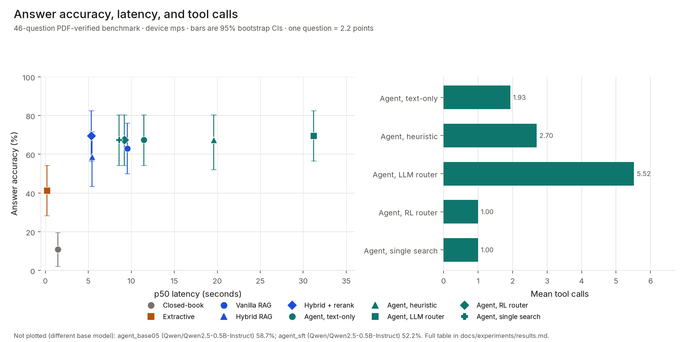
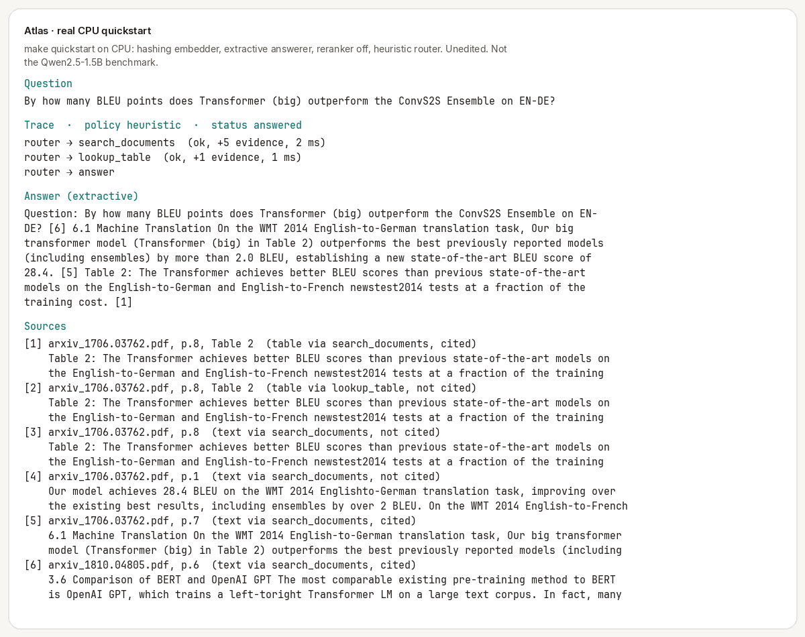
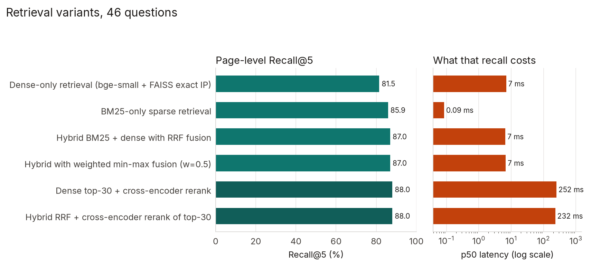
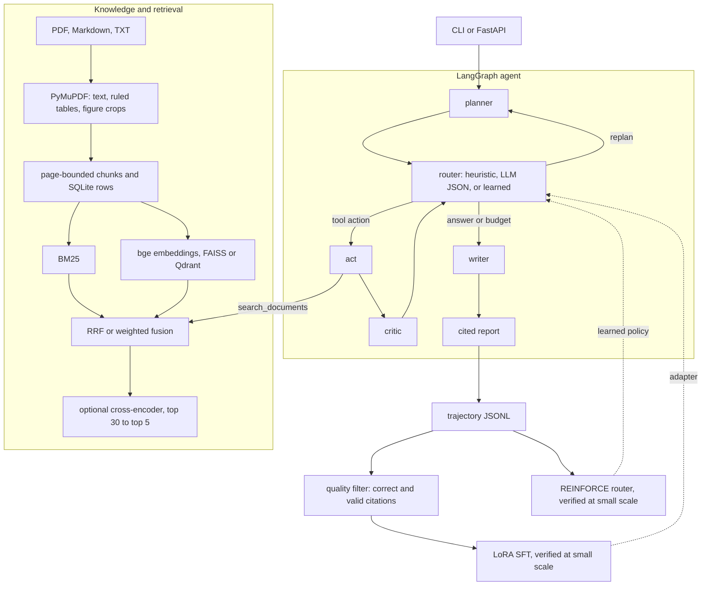
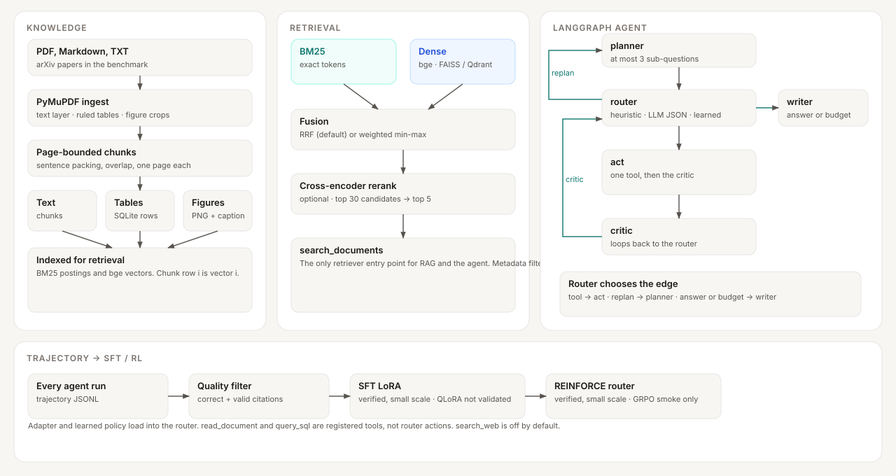

# Atlas

**Hand-built hybrid RAG and a LangGraph research agent: page-level citations, a 46-question benchmark with confidence intervals, LoRA SFT on its own trajectories, a REINFORCE tool router, and a FastAPI service.**

Every number on this page comes from a command in this repo. What was run, and what is only configured, is the [honesty contract](#honesty-contract).

[](https://github.com/mengchen-atx/PaperResearch-RL/actions/workflows/ci.yml)
[](pyproject.toml)
[](LICENSE)
[](pyproject.toml)
[](https://github.com/astral-sh/ruff)
[](https://github.com/mengchen-atx/PaperResearch-RL/actions/workflows/ci.yml)
[](docs/experiments/results.md)
[](https://github.com/mengchen-atx/PaperResearch-RL/pulls)
[](https://github.com/mengchen-atx/PaperResearch-RL/commits/main)
[](https://github.com/mengchen-atx/PaperResearch-RL)

[](https://fastapi.tiangolo.com)
[](https://pytorch.org)
[](https://github.com/langchain-ai/langgraph)
[](src/atlas/integrations/langchain.py)
[](https://huggingface.co)
[](https://github.com/facebookresearch/faiss)
[](docker/docker-compose.yml)

## Highlights

Same 46 PDF-verified questions, Qwen2.5-1.5B unless noted, Apple M4. One question is 2.2 points. Intervals are 95% bootstrap CIs.

- **Retrieval is the gain.** Closed-book Qwen2.5-1.5B scores 10.9% (2.2–19.6). Hybrid BM25 + dense with a cross-encoder scores **69.6%** (56.5–82.6).
- **Recall@5**, page-level: dense 81.5 → BM25 85.9 → hybrid 87.0 → hybrid + rerank **88.0**.
- **The agent ties the best RAG system and costs more.** The LLM router is also 69.6% (56.5–82.6), at 5.52 tool calls and 31.2 s p50. It does not beat single-shot RAG.
- **The RL router spends one search.** 67.4% (54.3–80.4), 1.00 tool call, 9.2 s p50. That matches a fixed single-search baseline on the same 46 questions (paired difference 0.0). [Why that happened](#reading-the-rl-and-sft-results).
- **LoRA SFT learned the protocol, not a better answer.** On Qwen2.5-0.5B, valid router JSON went from 71.0% to 100% and action accuracy from 45.2% to 71.0% (31 held-out steps). End-to-end accuracy fell: 52.2% vs 58.7% for the same 0.5B model without the adapter.
- **The API that was actually loaded.** `POST /retrieve`, 200 requests at concurrency 8: **0 errors**, 13.2 req/s. The inference numbers (TTFT 229 ms, 19.3 tok/s at concurrency 1) are the Hugging Face dev server, not vLLM.



## Quickstart

From a fresh clone. No model downloads. CI uses the same CPU torch wheel and `pip install -e ".[dev]"`, then ruff and the pytest line below. `make quickstart` is local only.

```bash
python -m venv .venv && source .venv/bin/activate
pip install torch --index-url https://download.pytorch.org/whl/cpu
pip install -e ".[dev]"
make quickstart PY=python
pytest tests -m "not slow"
```

`make quickstart` is the `quickstart` target in the `Makefile`. It downloads four arXiv v1 PDFs into `data/raw/`, builds `data/processed/quickstart_index`, then runs:

```bash
python -m atlas ask "What is the model dimension d_model used by the Transformer?"
python -m atlas research "By how many BLEU points does Transformer (big) outperform the ConvS2S Ensemble on EN-DE?"
```

with `ATLAS__EMBEDDING__PROVIDER=hashing`, `ATLAS__LLM__PROVIDER=extractive`, the reranker off, and heuristic planner/critic. `PY` defaults to `.venv/bin/python`, so after `make setup` you can run `make quickstart` with no `PY=`. This path does **not** produce the 69.6% number. That run needs [the full models](#full-setup).

CI on Python 3.11 and 3.12 then runs `ruff check src tests scripts` and the same pytest command. See [CONTRIBUTING.md](CONTRIBUTING.md).

<p align="center">
  
</p>

Unedited output of that research command on a CPU machine. Raw JSON: [`docs/assets/quickstart_research.json`](docs/assets/quickstart_research.json) and the ask capture [`docs/assets/quickstart_ask.json`](docs/assets/quickstart_ask.json). A full-model transcript, including wrong answers, is [`docs/experiments/demo_output.md`](docs/experiments/demo_output.md).

## Problem

A fluent answer to a research question is not a sourced one. The model misremembers numbers, cannot point at a page, and is weak on tables and charts. Atlas is the engineering response that was actually built and measured:

1. How much does retrieval help, and which stage (BM25, dense, fusion, rerank) moves Recall@5?
2. When does a multi-step agent beat one retrieval, and what does it cost in tool calls and latency?
3. Can a small open model learn the agent protocol from its own successful trajectories?
4. Can RL cut tool use without losing accuracy?
5. What does serving it take: async jobs, streaming, caching, and a path to vLLM and more than one machine?

On this benchmark the measured answers are: retrieval helps; the agent does not beat the best RAG; SFT learned the protocol and did not improve answers; the RL router collapsed to one search; vLLM and Kubernetes are configured and were not run.

## Design decisions

Longer notes, with the alternatives that were rejected: [ARCHITECTURE.md](ARCHITECTURE.md).

**Hybrid retrieval, then a cross-encoder.** BM25 hits model names and numbers. Dense retrieval (`bge-small-en-v1.5`, FAISS exact inner product) hits paraphrases. Their scores are not on one scale, so the default fusion is reciprocal rank fusion, not a weighted sum of raw scores. The cross-encoder reads query and chunk together, so it only reranks the top 30. Measured Recall@5 goes 81.5 → 88.0 along that stack. End-to-end is not monotone: hybrid without the reranker scored 58.7%, below vanilla dense RAG at 63.0%; adding the reranker reached 69.6%. Several remaining errors are the 1.5B generator misreading a number that was already in the evidence.

**A bounded LangGraph loop, not an open ReAct loop.** The graph is `planner → router → act → critic → router`. Only the router leaves the loop: `replan` back to the planner, or `answer` to the writer. Hitting `max_iterations` (6), `max_tool_calls` (8), or the wall-clock deadline is implemented inside the router, which then takes the answer edge. The action set is fixed, so a heuristic, an LLM JSON policy, and a learned policy are the same interface and can share one benchmark. The bound is load-bearing: the 1.5B LLM router reached the tool budget on 93.5% of questions.

**REINFORCE with a learned baseline.** Router episodes are a handful of discrete actions. The trainer is Monte Carlo advantage actor-critic: reward-to-go minus a learned value, plus an entropy bonus (`src/atlas/rl/train.py`). PPO is the wrong tool at this size; GRPO exists for the LLM router and was smoke-tested (2 steps), not trained to a result. The reward penalizes tool calls (`lambda_tool_cost` 0.03 in `configs/rl/reinforce.yaml`). On this benchmark that penalty wins: the learned policy issues one `search_documents` and never calls the table, SQL, or vision tools (`required_tool_recall` 0.0). It matches the no-learning single-search baseline question for question.

**Publish the interval, and say what did not run.** With 46 questions, a one-question swing is 2.2 points, and most ablation gaps sit inside the bootstrap interval. The contract is that a README number has a command and a file, and that vLLM, QLoRA, a built Docker image, and Kubernetes stay labeled "configured, not validated" until they are run.

## Engineering

**Tests.** `tests/` is offline: hashing embedder, extractive answerer, no downloads. `pytest tests -m "not slow"` is the CI command. One end-to-end test is marked `slow` and also skipped unless `ATLAS_RUN_SLOW=1`.

**CI.** [`.github/workflows/ci.yml`](.github/workflows/ci.yml) on Python 3.11 and 3.12: CPU PyTorch wheel, `pip install -e ".[dev]"`, `ruff check src tests scripts`, then the offline tests. `HF_HUB_OFFLINE=1`.

**Reproducibility.** Each ablation is a file in `configs/experiments/` that changes one knob. `make benchmark` and `make benchmark-agent` write `benchmarks/results/`. `make results` regenerates `docs/experiments/results.md` from the per-question JSONL. `python scripts/make_readme_figures.py` redraws the charts from those files and checks them against `summary.json`.

**Config.** `configs/default.yaml`, then optional YAML, then `ATLAS__SECTION__KEY`. API keys are not stored in YAML. A provider names an environment variable and the key is read at call time (`src/atlas/common/config.py`).

**API.** `python -m atlas serve` is FastAPI. Implemented routes: `GET /health`, `GET /ready`, `GET /metrics`, `POST /retrieve`, `POST /ask`, `POST /research` (202), `GET /research/{job_id}`, `GET /research/{job_id}/events` (SSE), `GET /traces/{trace_id}`, `GET /sessions`, `POST /documents`, `GET /`. OpenAPI is at `/docs`. The single-node process (memory queue, FAISS) is what the load test measured. Redis and Qdrant are config switches, exercised in tests with `fakeredis` and embedded Qdrant, not against live servers.

**Docker.** `docker/Dockerfile` and `docker/docker-compose.yml` describe api, workers, Redis, Qdrant, and an optional GPU vLLM profile. The image was not built here (no Docker daemon in the measurement environment). Kubernetes manifests under `deployment/kubernetes/` are parsed in `tests/unit/test_deploy_config.py` and were not applied.

## Headline results

46 PDF-verified questions, Apple M4 (MPS), same prompts. One question is 2.2 accuracy points. Charts are drawn by [`scripts/make_readme_figures.py`](scripts/make_readme_figures.py) from `benchmarks/results/*/records.jsonl` (95% bootstrap CIs, same seed as [`scripts/make_results_table.py`](scripts/make_results_table.py)). Regenerate with `python scripts/make_readme_figures.py`.




| System (same benchmark, same prompts) | Answer accuracy (95% CI) | Tool calls | p50 latency |
|---|---|---|---|
| Closed-book Qwen2.5-1.5B (no retrieval) | 10.9% (2.2–19.6) | – | 1.4 s |
| Extractive answerer, no LLM (retrieval floor) | 41.3% (28.3–54.3) | – | 0.17 s |
| Vanilla RAG (dense top-5) | 63.0% (50.0–76.1) | – | 9.5 s |
| Hybrid RAG (BM25 + dense, RRF) | 58.7% (43.5–71.7) | – | 5.4 s |
| **Hybrid + cross-encoder rerank RAG** | **69.6%** (56.5–82.6) | – | 5.3 s |
| Agent, text-only tools | 67.4% (54.3–80.4) | 1.93 | 11.5 s |
| Agent, heuristic router, all tools | 67.4% (52.2–80.4) | 2.70 | 19.6 s |
| Agent, LLM router | 69.6% (56.5–82.6) | 5.52 | 31.2 s |
| Agent, RL-learned router | 67.4% (54.3–80.4) | 1.00 | 9.2 s |
| Agent, fixed single-search baseline (no RL) | 67.4% (54.3–80.4) | 1.00 | 8.6 s |

Retrieval Recall@5 on the same 46 questions: dense 81.5 → BM25 85.9 → hybrid 87.0 → hybrid + rerank 88.0.

**What these numbers say**

- Retrieval is the big win (10.9% → 63–70%).
- Agents match, but do not beat, the best single-shot RAG on this benchmark.
- The RL router does not beat a fixed "search once, then answer" pipeline. [Details](#reading-the-rl-and-sft-results).
- SFT on Qwen2.5-0.5B taught the agent protocol and lowered end-to-end accuracy versus that 0.5B model without the adapter (52.2% vs 58.7%). Those two rows are omitted from the chart because they are a different base model.

Full tables, per-type breakdown, held-out split, RL, SFT, and serving: [`docs/experiments/results.md`](docs/experiments/results.md). Reproduce with `make benchmark`.

## Architecture

The agent is the LangGraph in `src/atlas/agents/graph.py`: `planner → router → act → critic → router`, and the router alone chooses `replan` (back to the planner) or `answer` (the writer). Budget exhaustion is inside the router; it forces the answer action. `search_documents` is the retriever (`BM25` and dense, then RRF or weighted fusion, then an optional cross-encoder).



Router tools are `search_documents`, `lookup_table`, `analyze_image` (action name `analyze_visual`), `run_python`, and `search_web` (off by default). `read_document` and `query_sql` are registered on the executor and the LangChain adapter; they are not router actions. QLoRA is configured and was not run. GRPO had a 2-step smoke run, not a full training run. A static export of the same flow is below and at [`docs/assets/architecture.svg`](docs/assets/architecture.svg).



The why, alternatives, and costs are in **[ARCHITECTURE.md](ARCHITECTURE.md)**.
Design notes: [RAG](docs/design/rag.md) · [post-training](docs/design/post_training.md) ·
[agentic RL](docs/design/agentic_rl.md) · [serving](docs/design/serving.md) · [evaluation](docs/design/evaluation.md).
What ran versus what is only configured: **[IMPLEMENTATION_STATUS.md](IMPLEMENTATION_STATUS.md)**.
Milestones: **[ROADMAP.md](ROADMAP.md)**.

## Features

| Area | What is implemented | Status |
|---|---|---|
| RAG from scratch | PyMuPDF parsing, sentence-packing chunker, bge-small embeddings, NumPy and FAISS cosine search, cited generation | Verified |
| Advanced retrieval | Okapi BM25 (hand-written), hybrid RRF / weighted fusion, cross-encoder reranking, metadata pre-filtering, Qdrant adapter | Verified |
| Multimodal | ruled-table extraction to SQL tools; vector-chart figure crops; VLM abstraction (local SmolVLM, OpenAI-compatible, Anthropic) | Verified (weak local VLM) |
| LangChain interop | `AtlasRetriever` and `StructuredTool` wrappers (`atlas/integrations/langchain.py`) | Verified (tests + real index) |
| Agent | LangGraph state machine, 7-action tool space, 3 interchangeable policies, critic loop, budgets, dedupe memory, fallbacks | Verified |
| Evaluation | PDF-verified benchmark; retrieval, answer, groundedness, citation, agent, and system metrics; bootstrap CIs | Verified |
| Post-training | trajectory schema, filtering, trajectory to SFT data, TRL + PEFT LoRA, QLoRA path, base-vs-adapter eval | LoRA verified at small scale; QLoRA configured, not validated |
| Agentic RL | MDP over the production nodes, reward with potential shaping, actor-critic REINFORCE, GRPO entry point | Router RL verified at small scale; GRPO smoke only |
| Serving | FastAPI sync/async/SSE, job queue (memory/Redis), worker, uploads, traces, metrics, dev model server | Verified locally; vLLM configured, not validated |
| Deployment | Dockerfile, Compose, Kubernetes manifests (HPA, KEDA, GPU vLLM, ingress) | Configured, not validated; manifests statically checked in tests |

## Full setup

Requirements: Python 3.11+, [uv](https://docs.astral.sh/uv/), about 6 GB of disk for models. A GPU is optional (CUDA or Apple MPS are used when present).

```bash
make setup      # uv venv + `pip install -e ".[train,vision,dev]"` (dev extra is needed for pytest)
make data       # downloads 4 public arXiv papers (v1) and builds + verifies the benchmark
make ingest     # atlas ingest data/raw  → 4 docs → 426 text / 12 table / 37 figure chunks
make test       # offline test suite (no model downloads)
```

First run downloads the models from the Hugging Face Hub: Qwen2.5-1.5B-Instruct, bge-small-en-v1.5, ms-marco-MiniLM-L-6-v2, and SmolVLM-256M-Instruct.

### Ask (single-shot RAG)

```bash
python -m atlas ask "What is self-attention?"
```

Real output (abridged). Answer, then evidence with document, page, section, retriever, and score:

```
Answer (Qwen/Qwen2.5-1.5B-Instruct):
Self-attention, also known as intra-attention, is an attention mechanism ... relating different positions of a
single sequence ... [1] ...

Retrieved evidence:
  [1] arxiv_1706.03762.pdf, p.2 score=9.5273 via=hybrid-rrf+cross_encoder section='2 Background'
  [2] arxiv_1706.03762.pdf, p.6 score=4.9797 via=hybrid-rrf+cross_encoder section='4 Why Self-Attention'
  ...
latency: retrieval 596 ms, generation 9792 ms; tokens: 825 in / 167 out
```

### Research (multi-step agent)

```bash
python -m atlas research "By how many BLEU points does Transformer (big) outperform the ConvS2S Ensemble on EN-DE?"
python -m atlas research "..." --policy llm       # LLM router
python -m atlas research "..." --policy learned   # RL-trained router
```

It prints the plan, every router decision and tool call (arguments, latency, new evidence), critic verdicts, and a report with cited sources. The trajectory is appended to `data/trajectories/trajectories.jsonl`. Unedited runs of the demo scenario (text, table + compute, figure, multi-hop) are in [`docs/experiments/demo_output.md`](docs/experiments/demo_output.md) (`python scripts/demo.py`).

### Serve (API + UI)

```bash
python -m atlas serve --port 8000      # UI at http://localhost:8000, OpenAPI docs at /docs
curl -s localhost:8000/ask -H 'content-type: application/json' -d '{"question":"What is BM25?"}'
curl -s localhost:8000/research -H 'content-type: application/json' -d '{"query":"What does Figure 1 of the RAG paper show?"}'
# → 202 {"job_id": ..., "events_url": "/research/<id>/events"}   (Server-Sent Events progress)
curl -N localhost:8000/research/<id>/events
```

### Use a different model provider

```bash
ATLAS__LLM__PROVIDER=openai_compatible ATLAS__LLM__BASE_URL=http://gpu-host:8000/v1 ATLAS__LLM__MODEL=Qwen/Qwen2.5-7B-Instruct python -m atlas ask "..."   # vLLM — configured, not validated
ATLAS__LLM__PROVIDER=anthropic ATLAS__LLM__MODEL=claude-haiku-4-5 ANTHROPIC_API_KEY=... python -m atlas ask "..."
ATLAS__LLM__PROVIDER=extractive python -m atlas ask "..."   # no LLM: extractive baseline, fully offline
```

## Design summary

**RAG.** Chunks are sentence-packed to about 1000 characters with 150 characters of overlap and never cross pages, so each chunk has one exact page citation. Retrieval is hybrid: BM25 catches exact tokens (model names, numbers), dense retrieval catches paraphrase. RRF fuses the two by rank, which avoids score-scale mismatch. A cross-encoder reranks the top 30. The prompt numbers evidence `[n]`, and the papers' own bibliography brackets are rewritten to `(ref n)` so the model cannot confuse them with our citations. Invalid markers are detected.

**Agent.** A LangGraph cycle of planner → router → act → critic, which then loops or hands off to the writer. The router picks from a fixed action space, so heuristic, LLM, and RL policies are interchangeable and comparable. Budgets (iterations, tool calls, wall clock), duplicate-call memory, and fallbacks prevent runaway loops. Failures are recorded, not fatal.

**Multimodal.** Content goes to the cheapest correct extractor. Text comes from the text layer. Ruled tables go to SQLite, so arithmetic is exact. Figure crops are located via their captions (this works for vector charts), and a VLM is called only when a question needs pixels.

**Post-training.** The agent's own successful, citation-valid trajectories become SFT data: router steps are rebuilt with the exact evidence prefix, plus writer examples. Training uses LoRA on a small Qwen model, with a QLoRA path for 7B-class models on CUDA (configured, not validated). Evaluation compares action accuracy on held-out trajectories.

**Agentic RL.** The MDP's transitions *are* the production node functions, so a trained policy runs unchanged in the agent. The reward is task success + citation precision + potential-shaped evidence recall − tool cost − steps. The router is trained with REINFORCE plus a learned baseline. A GRPO path exists for LLM routers.

**Serving.** Research runs are async jobs (202 + SSE) backed by an in-process queue or by Redis plus workers (idempotency keys, at-least-once delivery, bounded retries, graceful shutdown). Caching covers retrieval, temperature-0 LLM calls, and embeddings. vLLM would sit behind the same OpenAI-compatible client (configured, not validated; locally an HF dev server stands in). Every request carries a trace id, and spans cover nodes, tools, retrieval, and LLM calls.

**Distributed.** API replicas scale on CPU (HPA). Workers scale on queue depth (KEDA), because they mostly wait on inference. vLLM runs one GPU per replica, with prefix caching and multi-LoRA. Qdrant serves shared vector search. The ingress handles rate limiting and SSE timeouts. All of this is configured, not validated (no GPU or cluster available); manifests are only statically checked.

## Evaluation methodology

* **Benchmark**: `data/benchmarks/atlas_papers_v1.jsonl`, 46 questions over *Attention Is All You Need*, BERT, RAG (Lewis et al.), and *Scaling Laws for Neural Language Models*. By type: 28 text, 8 table, 4 compute, 4 figure, 2 multi-hop. Each question has a gold answer and aliases, and numeric questions have a tolerance. Gold evidence is recorded as (file, pages, quote), and `scripts/build_benchmark.py` checks every quote against the actual PDF page before writing the file.
* **Retrieval**: Recall@K, Precision@K, MRR, and nDCG@K, with page-level relevance where each gold unit is credited once.
* **Answers**: numeric match within tolerance, or boundary-aware containment of the gold answer or an alias, plus token F1.
* **Groundedness**: share of answer sentences whose content words appear in the evidence. This is a *lexical proxy*, not an NLI judgment.
* **Citations**: validity (markers point to real evidence), precision (cited evidence is on a gold page), and coverage.
* **Agent**: success, completion, tool calls, failed / unproductive / duplicate calls, replans, policy fallbacks, and required-tool recall.
* **System**: p50/p95 latency, tokens per query, cost (0 for self-hosted), API load test, and inference TTFT and tokens/s.
* **Controlled ablations**: each `configs/experiments/*.yaml` overrides only the variable under test. Same model, prompts, and benchmark.

```bash
make benchmark-retrieval          # 6 retrieval variants, ~1 min
make benchmark                    # + base LLM / extractive / vanilla / hybrid / hybrid+rerank RAG
make benchmark-agent              # agent policies; also writes evaluated trajectories
python scripts/run_benchmark.py configs/experiments/agent_learned.yaml
make results                      # regenerate docs/experiments/results.md
python scripts/make_readme_figures.py   # regenerate the README charts
```

## Post-training and RL commands

```bash
make benchmark-agent                                   # collect evaluated trajectories
python -m atlas trajectories validate data/trajectories/agent_heuristic.jsonl
python scripts/train_sft.py -c configs/sft/lora.yaml   # LoRA SFT + base-vs-adapter eval (MPS/CPU/CUDA)
python scripts/train_sft.py -c configs/sft/qlora.yaml  # QLoRA, 7B, needs CUDA — configured, not validated
python scripts/train_rl.py -c configs/rl/reinforce.yaml   # router policy RL (CPU/MPS, minutes)
python scripts/train_grpo.py --smoke                   # GRPO pipeline check; full runs need a GPU
python scripts/run_benchmark.py configs/experiments/agent_sft.yaml configs/experiments/agent_learned.yaml
```

## Reading the RL and SFT results

**About the RL result.** The REINFORCE router reaches the heuristic router's accuracy (67.4% vs 67.4% on 46 questions) with 1.00 vs 2.70 tool calls and 9.2 s vs 19.6 s p50 latency. But it does this by collapsing to a single `search_documents` call on every question: `required_tool_recall` is 0.0 in `benchmarks/results/agent_learned/summary.json`, so it never uses the table, SQL, or vision tools. On this benchmark one good hybrid + rerank search is usually enough, and the tool-cost penalty (`lambda_tool_cost` in `configs/rl/reinforce.yaml`) makes extra calls unprofitable. The fixed `agent_single_search` baseline (one search, then the writer, no learning) confirms this: it is correct on exactly the same 46 questions as the learned router (paired accuracy difference 0.0, bootstrap 95% CI [0.0, 0.0]; 42 of 46 answers are textually identical), at 8.6 s p50. So the learned policy is equivalent to that fixed pipeline here. Testing whether RL can learn *when* extra tools pay off needs a benchmark with many more table, arithmetic, and figure questions (roadmap).

On the RL environment's own 13 held-out questions, the learned router matches the heuristic's success (46.2%) with 1.00 vs 1.69 tool calls; a random policy scores 30.8%.

**About SFT.** LoRA on Qwen2.5-0.5B (31 held-out router steps) moved valid JSON from 71.0% to 100% and correct action from 45.2% to 71.0%. End-to-end, the adapted agent scored 52.2% versus 58.7% for the same 0.5B model without the adapter. The trajectories used for that run had no writer examples (a metadata bug, since fixed and regression-tested). It imitated budget-forced router steps. That is protocol-following, not a better answerer.

## Serving and inference benchmarks

```bash
python -m atlas serve-model --port 8001                # OpenAI-compatible HF server (vLLM stand-in)
python scripts/bench_inference.py --base-url http://127.0.0.1:8001/v1 --concurrency 4
docker compose -f docker/docker-compose.yml --profile gpu up   # vLLM + api + workers + redis + qdrant (GPU host) — configured, not validated
python scripts/bench_inference.py --base-url http://localhost:8001/v1 --model Qwen/Qwen2.5-7B-Instruct --concurrency 16
python scripts/run_system_benchmark.py --endpoint retrieve --concurrency 8 --requests 200
kubectl apply -k deployment/kubernetes                 # requires a cluster (+ KEDA, GPU nodes)
```

Measured on the HF dev server on M4, not vLLM: TTFT 229 ms, 19.3 tok/s at concurrency 1; no throughput gain at concurrency 4 (no batching). API load test, `/retrieve`, 200 requests at concurrency 8: 13.2 req/s, 0 errors (p50 1 ms is cache hits; p95 1.8 s).

Single-node mode (`atlas serve`, in-memory queue, FAISS) is the default and is what all measurements used. Distributed mode switches config only: `ATLAS__SERVING__QUEUE_BACKEND=redis`, `ATLAS__RETRIEVAL__VECTOR_STORE=qdrant`, and `atlas worker` processes.

## Project structure

```
.
├── src/atlas/          library
│   ├── retrieval/      BM25, FAISS/NumPy/Qdrant, RRF and weighted fusion
│   ├── reranking/      cross-encoder
│   ├── agents/         LangGraph planner, router, act, critic, writer
│   ├── rag/            prompts and page-level citation checks
│   ├── rl/             REINFORCE router
│   ├── training/       trajectory → LoRA SFT
│   ├── serving/        FastAPI, jobs, SSE, dev model server
│   └── tools/          documents, SQL, Python sandbox, visual, web
├── configs/            default.yaml, experiments/, sft/, rl/
├── scripts/            benchmarks, training, corpus download, README figures
├── tests/              unit/, integration/, e2e/  (offline; one slow real-model test)
├── benchmarks/results/ committed per-question JSONL and summary.json
├── docs/               design notes, experiment write-up, README assets
├── docker/             Dockerfile and Compose (not built in CI)
├── deployment/kubernetes/  manifests, statically checked, not applied
├── Makefile            setup, quickstart, test, benchmark, figures
└── pyproject.toml
```

Other packages under `src/atlas/`: `ingestion`, `chunking`, `embeddings`, `multimodal`, `llm`, `evaluation`, `trajectory`, `integrations` (LangChain), `memory`, `observability`, `common`.

## Honesty contract

Every number in this README is generated by a command in this repo and stored under `benchmarks/results/` or `data/processed/`. What ran versus what is only configured is listed in [IMPLEMENTATION_STATUS.md](IMPLEMENTATION_STATUS.md). No vLLM, Kubernetes, or QLoRA numbers are claimed, because no NVIDIA GPU or cluster was available.

The README charts read `benchmarks/results/` only. SFT and RL summary files under `data/processed/` are not in the git tree (training artifacts are gitignored); the SFT and RL figures quoted above are the ones already published in [`docs/experiments/results.md`](docs/experiments/results.md), which `scripts/make_results_table.py` writes when those files are present.

## Limitations

* The benchmark is small (46 questions, one domain). Most ablation differences fall inside the CIs.
* The generator is a local 1.5B model. Several errors are misread numbers even when the right evidence was retrieved, which is why better retrieval does not always improve end-to-end accuracy.
* Groundedness is a lexical proxy. Answer matching is containment-based, so a verbose answer that contains the gold span counts as correct.
* Table detection handles ruled tables only. The local 256M VLM reads charts poorly; use a 7B or hosted VLM.
* RL uses an extractive writer inside rollouts and a small train/test split. The learned router mainly learned *when to stop*, not when to use table or figure tools.
* LLM routers rarely decide to stop. The 1.5B router chose `answer` itself in 3 of 46 runs; the rest ended at the tool budget.
* SFT imitated those trajectories and trained on router examples only (a metadata bug dropped writer examples; fixed and regression-tested). It improved protocol-following but lowered end-to-end accuracy versus its 0.5B base. Next: filter out budget-forced steps and re-collect data with writer examples.
* Multimodal tools help only marginally here: table questions 37.5% → 50% with the table tools; compute questions 0% for all agents. The demo output (`docs/experiments/demo_output.md`) is unedited and includes wrong answers.
* vLLM, real Redis, Docker images, Kubernetes, QLoRA, and full GRPO runs were not executed here (no NVIDIA GPU, Docker daemon, or cluster). See [IMPLEMENTATION_STATUS.md](IMPLEMENTATION_STATUS.md).

## Roadmap

See [ROADMAP.md](ROADMAP.md). The next items are a larger benchmark with unanswerable and pixel-only questions, NLI and LLM judges, real vLLM measurements, and GRPO at scale.

## License

MIT. Copyright (c) 2026 Meng Chen. See [LICENSE](LICENSE).

The corpus is public arXiv papers downloaded by `scripts/download_corpus.sh` and is not redistributed.

[Contributing](CONTRIBUTING.md) · [Changelog](CHANGELOG.md) · [Cite this project](CITATION.cff)
